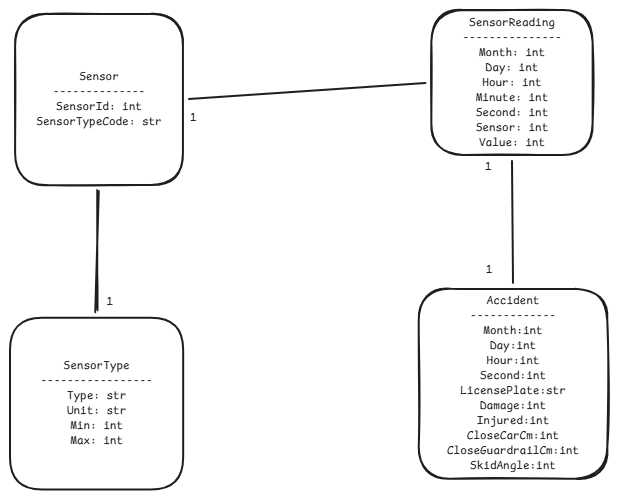
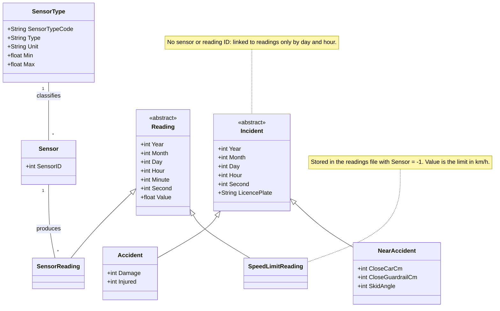
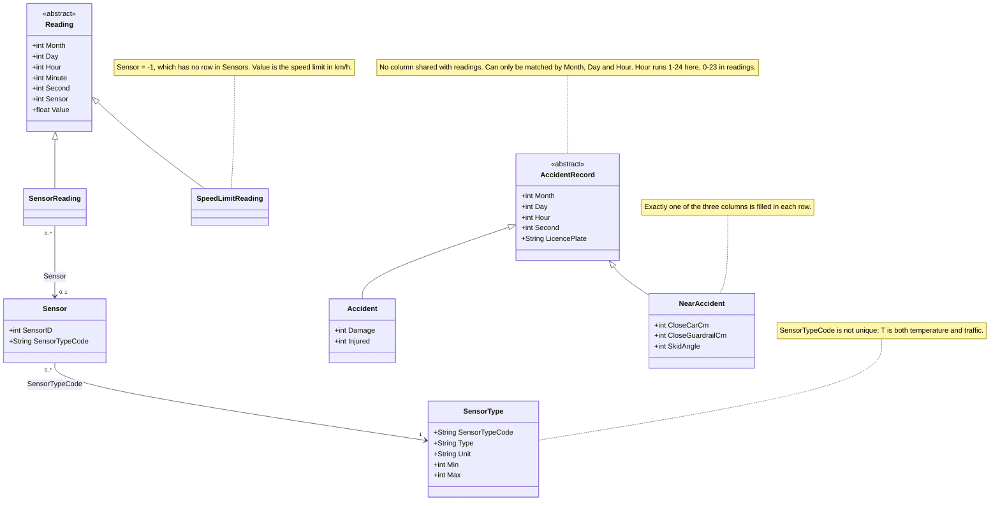

# 5. Data structure (case study, slide 16)

Show the structure of the data in a class diagram.

## Round 1

## Round 2

The diagram shows the data as it is stored in the CSV files, before cleaning. The problems it reveals are listed in [06 Data problems](06-data-problems.md).

| Class | File | Notes |
|---|---|---|
| SensorType | `SensorTypes` | One row per kind of measurement, with its unit and valid range. |
| Sensor | `Sensors` | One row per physical sensor, pointing to its type. |
| SensorReading | `SensorReadings` (Year N, Year N+1) | One reading per sensor per hour, at a random minute and second. |
| SpeedLimitReading | `SensorReadings` | The rows with Sensor = -1 (case study, slide 6). |
| Accident, NearAccident | `Accidents` (Year N, Year N+1) | One file for both kinds of event. |

Modelling choices:

- **Foreign keys are shown as associations.** `Sensor.SensorTypeCode` and `SensorReading.Sensor` are the lines between the classes, not attributes.
- **Year is an attribute, not a class.** It is not a column in any file. It comes from the file name (Year N or Year N+1).
- **The speed limit is its own class.** It shares the readings file and its columns, but it is not measured by a sensor in the sensors file. It is what the network will learn to set.
- **Accident and NearAccident are subclasses of Incident.** Every row fills either Damage (and sometimes Injured) or exactly one of CloseCarCm, CloseGuardrailCm and SkidAngle, never both. Each subclass only has the columns that apply to it.
- **There is no association between Incident and Reading.** The accidents file has no sensor ID or location, so incidents can only be matched to readings by day and hour.
- **Multiplicities are `*` (zero or more) on purpose.** Sensors 7, 10 and 17 have no readings, and the traffic type has no sensor that is clearly its own.

## Round 3

| Class | Source file | Notes |
|---|---|---|
| SensorType | `SensorTypes_V100` | 9 rows. Code `T` appears twice. |
| Sensor | `Sensors_V100` | 18 rows, IDs 1 to 18, all unique. |
| Reading (abstract) | `SensorReadingsYearN_V100`, `SensorReadingsYearNPlus1_V100` | 12,648 rows each. The Year N+1 file has no header row. |
| SensorReading | same | Rows with Sensor 1 to 19. Sensors 7, 10 and 17 have no rows. Sensor 19 has rows but is not in `Sensors`. |
| SpeedLimitReading | same | Rows with Sensor = -1, one per hour (744), values 40 to 80. |
| AccidentRecord (abstract) | `AccidentsYearN_V100`, `AccidentsYearNPlus1_V100` | 997 and 844 rows. No Minute column. |
| Accident | same | Rows with Damage filled (32 and 21). Injured is blank in 22 and 15 of them. |
| NearAccident | same | Rows with CloseCarCm, CloseGuardrailCm or SkidAngle filled (964 and 822). |

Modelling decisions:

- **The files are drawn as stored.** The foreign key columns (`SensorTypeCode`, `Sensor`) stay as attributes and are also drawn as associations labelled with the column name. Types are inferred from the values. Only `Value` has decimals.
- **Each Year N and Year N+1 pair is one class.** Both files in a pair have the same columns. The year is only in the file name, so it is not an attribute.
- **The readings file holds two kinds of record.** Sensor = -1 is the speed limit, not a measurement. This comes from the case study (slide 6), not from the data. *(assumed)*
- **The accidents file holds two kinds of record.** This was seen in the data: every row fills either Damage or exactly one near-accident column, never both. One row in each file fills neither (Year N line 461, Year N+1 line 87) and fits neither subclass.
- **Multiplicities show the data, not the intended design.** A reading points to 0..1 sensors because sensor 19 has no row. A sensor points to exactly 1 type because that is the intent, but code `T` breaks it. *(assumed)*

## Comparison
I am actually content with the initial class diagram which I made in round 1, barring some errors I made. The first mistake was not putting the SensorTypeCode attribute in SensorType. I represented the data correctly as is apart from that, specifying the instances where an entity can only possess one of another entity which is the important part. But I did leave out some correct notation and also methods of abstracting the logic I was trying to represent which I was not aware of.

Round 2 added some new representations of the data, with the errors I had made manually amended. Mermaid diagrams are more useful for markdown but I find can be hard to read when they get larger.

Round 3 created subclasses such as NearAccident. It had better notation showing the relationships between entitities and what their foreign key references are, e.g the value SensorTypeCode in class Sensor points to a class SensorType. 

The LLM rounds helped solve errors in my initial diagram, implement it in a mermaid diagram which is more standard, and abstract the logic into a better representation as well as come up with enhanced logic such as the subclasses. An important thing to note with LLM diagrams is to constantly verify them to make sure they are human-readable too.