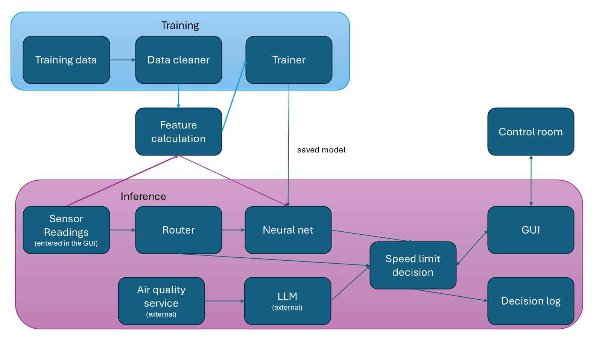
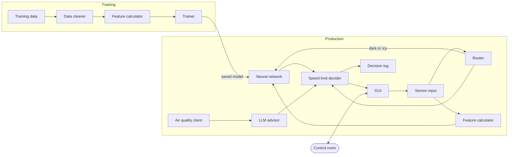
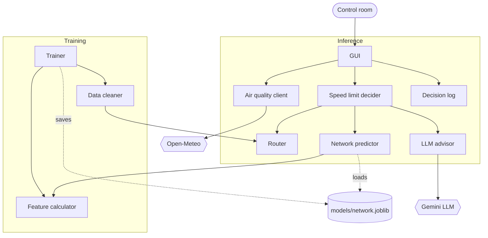

# 8. Architecture (SpeedLimit21)

Design the architecture of the whole software, covering the training phase and the production phase. Give each component a name and a one-sentence description, draw the architecture, and explain how the components work together to turn sensor readings and other input into a speed limit. Write five test cases per component. Then explain which components change, and how, for each new requirement: some temperature sensors return Fahrenheit; only skidding counts as a near-accident; electric cars are exempt from limits caused by bad air quality.

## Round 1

## Round 2

### Components

**Training phase**

| Component | Description |
|---|---|
| Training data | The CSV files with sensor types, sensors, sensor readings and accidents for Year N and Year N+1. |
| Data cleaner | Repairs the data errors from 06 and turns the files into one row per hour. |
| Feature calculator | Turns light, water, temperature and the speed limit into normalized network inputs. |
| Trainer | Trains the neural network on the dark or icy hours and saves it. |

**Production phase**

| Component | Description |
|---|---|
| Sensor input | Delivers the current light, water and temperature readings (in the MVP, typed into the GUI). |
| Router | Decides whether it is dark or there is a danger of black ice (SPEC1, SPEC2). |
| Neural network | Predicts the number of near-accidents per hour for a speed limit under the current conditions. |
| Air quality client | Reads the current air quality from the Open-Meteo API. |
| LLM advisor | Asks the LLM how far to lower the limit when the air quality is poor. |
| Speed limit decider | Combines the router, network and LLM results into one limit, following REQ1 to REQ8. |
| GUI | Lets the user enter readings and the control room override the limit, and shows the decision. |
| Decision log | Writes every decision to a CSV file. |

### Diagram

### How the components work together

1. In training, the data cleaner reads the training data, the feature calculator turns each dark or icy hour into inputs, and the trainer fits the network and saves it.
2. In production, the readings arrive and the router checks whether it is dark or icy.
3. If it is, the network predicts near-accidents for 40, 50, 60 and 70 km/h, and the decider picks the highest limit with at most 1.
4. In parallel, the air quality client reads the AQI. Above 40, the LLM advisor returns a reduction of 10 to 40 km/h.
5. The decider takes the lower of both limits, or 80 km/h if neither applies, and the GUI shows it. The control room can override it, and every decision is logged.

### Test cases (five per component)

- **Data cleaner:** trims `W ` to `W`; maps sensor 16 to traffic; reads the Year N+1 file without a header; turns accident hour 24 into 23; fills hours without events with 0.
- **Feature calculator:** 0 °C becomes 0.3; 10,000 µm becomes 1; 40 km/h becomes 0; 80 km/h becomes 1; the same reading gives the same features in training and production.
- **Trainer:** trains only on dark or icy hours; leaves days 25 to 31 out of training; saves a file the app can load; beats always predicting the average; gives the same result with the same seed.
- **Sensor input:** passes light, water and temperature on unchanged; converts lux to millilux; marks an empty field as missing; accepts decimals; rejects text.
- **Router:** 499 mlx is dark; 500 mlx is not; 1001 µm at −1 °C is icy; 1000 µm at −1 °C is not; 1001 µm at 0 °C is not.
- **Neural network:** never predicts below 0; never predicts fewer near-accidents at a higher limit; predicts 80 km/h the same as 70; returns a number for any valid input; loads the saved model only once.
- **Air quality client:** returns the AQI and four pollutants; raises an error on an HTTP error; raises an error after a timeout; uses the given coordinates; returns numbers, not text.
- **LLM advisor:** AQI 40 gives 0 without calling the LLM; AQI 41 gives 10, 20, 30 or 40; an answer of 25 is rejected; a worse AQI never gets a smaller reduction; the reason is one sentence.
- **Speed limit decider:** nothing applies gives 80; dark gives the network's limit; dark and AQI reduction 30 gives the lower limit; a missing reading gives 60; an override replaces the calculated limit.
- **GUI:** shows the limit after "Set speed limit"; shows a warning for a missing reading; shows the override; recalculates every hour when the toggle is on; switches between live and manual air quality.
- **Decision log:** creates the file with a header; appends one row per decision; doesn't repeat the header; writes an empty AQI when it is missing; joins several warnings in one cell.

### Change requests

- **Some temperature sensors return Fahrenheit.** The data cleaner converts those sensors to Celsius before averaging, and the sensor input does the same in production. The router, feature calculator and network stay unchanged because they always get Celsius.
- **Only skidding counts as a near-accident.** The data cleaner counts only rows with SkidAngle, and the trainer retrains the network. Nothing else changes.
- **Electric cars are exempt from limits caused by bad air quality.** The speed limit decider returns two limits, one for electric cars (without the LLM reduction) and one for all others. The GUI and the decision log show both.

## Round 3

Follows the architecture decks: an architecture is the components plus an allowed-to-use specification (which component may use which). Each component has one job, offers services and holds knowledge in some form. AI components have a training phase and an inference phase. The design matches the code in `app/` and `training/`.

### Components

| Component | Job | Knowledge and its form | Type | Code |
|---|---|---|---|---|
| **Training** | | | | |
| Data cleaner | Repairs the data errors from 06 and turns the raw files into one row per hour with readings, speed limit and near-accident count. | The cleaning rules from 06 (source code) | Software 1.0 | `training/clean.py` |
| Feature calculator | Turns light, water, temperature and a speed limit into four inputs between 0 and 1. | Log scale for light, Min and Max from SensorTypes (source code) | Software 1.0 | `app/features.py` |
| Trainer | Trains the network on the dark or icy hours of days 1 to 24, tests it on days 25 to 31 and saves it. | Network size and training settings (source code) | Software 1.0 | `training/train.py` |
| **Inference** | | | | |
| Router | Decides whether it is dark (SPEC1) or there is a danger of black ice (SPEC2). | The two thresholds (source code) | Software 1.0 | `app/router.py` |
| Network predictor | Predicts near-accidents per hour for a speed limit under the current conditions. | How conditions and limit relate to near-accidents (network weights in `models/network.joblib`) | Software 2.0 | `app/network.py` |
| Air quality client | Reads the current European AQI and pollutants for the highway's coordinates. | The Open-Meteo address and fields (source code) | Software 1.0 | `app/air_quality.py` |
| LLM advisor | Gets a reduction of 10 to 40 km/h from the LLM when the AQI is above 40. | What reduction fits which air quality (in the LLM) | Software 3.0 | `app/air_quality.py` |
| Speed limit decider | Combines the router, network and LLM results into one limit (REQ1 to REQ8). | The business rules (source code) | Software 1.0 | `app/speed_limit.py` |
| GUI | Takes the readings (standing in for the sensors in the MVP) and the override, and shows the limit and warnings. | Screen layout (source code) | Software 1.0 | `app/main.py` |
| Decision log | Writes every decision with its inputs and result to a CSV file (SPEC7). | The log format (source code) | Software 1.0 | `app/decision_log.py` |
| **Outside the software** | | | | |
| Control room | Watches the warnings and overrides the limit when needed (REQ8). | Experience on the road | Human in the loop | – |
| Sensors, Open-Meteo, Gemini | Deliver readings, air quality and LLM answers. | – | External | – |

### Allowed-to-use specification

An arrow means "uses". Any use not shown is forbidden.

The feature calculator and the router are used in both phases. That way training and inference compute features and the dark or ice rules in exactly the same way.

### How a speed limit is set

1. The GUI collects light, water and temperature, and the air quality from the air quality client (or entered by hand).
2. The speed limit decider asks the router whether it is dark or icy. If a reading is missing, it uses 60 km/h instead (REQ6).
3. If it is dark or icy, the network predictor rates 40, 50, 60 and 70 km/h. The decider takes the highest limit with at most 1 predicted near-accident, otherwise 40 km/h plus a warning (SPEC3b).
4. If the AQI is above 40, the LLM advisor returns a reduction. If the answer is missing or not 10, 20, 30 or 40, there is no reduction and the control room is warned (REQ7).
5. The decider takes the lower of both limits, or 80 km/h if neither applies (REQ3, REQ4). An override from the control room replaces it (REQ8).
6. The GUI shows the limit and warnings, and the decision log stores everything.

### Quality of the architecture

- **One job per component:** mostly yes. `air_quality.py` holds two components (the client and the LLM advisor). They should be two files, because an API change and a prompt change are different reasons to change.
- **Don't repeat yourself:** the router and the feature calculator are shared by training and inference instead of being written twice.
- **Models separated from business logic:** the network predictor only predicts. All rules (thresholds, 40 km/h fallback, lower limit wins) are in the speed limit decider, so they can change without retraining.
- **Output guardrails:** the network predictor never returns less than 0 and never rates a higher limit as safer. The decider only offers 40 to 70 km/h to the network. The LLM's answer must be 10, 20, 30 or 40.
- **No cycles:** checked in the code's imports. Every arrow points one way.
- **Coupling:** the GUI uses the air quality client directly. Letting the decider fetch the air quality would remove one dependency from the GUI.

### Test cases (five per component)

**Data cleaner** (`training/clean.py`)

| # | Input | Expected |
|---|---|---|
| 1 | SensorTypes row `W ;water` | Code `W`, which matches water sensors 1, 8 and 11 |
| 2 | Sensors file | Sensor 16 is traffic (`TR`), sensor 19 is added as temperature |
| 3 | Year N+1 readings, which have no header | 12,648 rows with the columns Month to Value |
| 4 | Accident row with hour 24 | Counted in hour 23 |
| 5 | Year N in total | 744 hours, 964 near-accidents, 32 accidents, no missing values |

**Feature calculator** (`app/features.py`)

| # | Input | Expected |
|---|---|---|
| 1 | Light 0 lux and 1,000,000 lux | 0.0 and 1.0 |
| 2 | Water 0 and 10,000 µm | 0.0 and 1.0 |
| 3 | Temperature −30, 0 and 70 °C | 0.0, 0.3 and 1.0 |
| 4 | Speed limit 40 and 80 km/h | 0.0 and 1.0 |
| 5 | The same reading in training and in the app | The same four numbers |

**Trainer** (`training/train.py`)

| # | Input | Expected |
|---|---|---|
| 1 | Year N | Trains on 307 hours, all dark or icy, from days 1 to 24 |
| 2 | Year N | No test hour (days 25 to 31) is used for training |
| 3 | Training run | `models/network.joblib` exists and the app can load it |
| 4 | Test days | Error no worse than always predicting the average (0.859 vs 0.875) |
| 5 | Made-up data where near-accidents rise with the limit | The trained network predicts more near-accidents at 70 than at 40, which proves the pipeline can learn a real relationship |

**Network predictor** (`app/network.py`)

| # | Input | Expected |
|---|---|---|
| 1 | Any valid conditions and limit | A prediction of at least 0 |
| 2 | Dark (100 mlx, 0 µm, 5 °C) at 40 and 70 km/h | Prediction at 70 is not lower than at 40 |
| 3 | Same conditions at 80 km/h | Same prediction as at 70 (never extrapolated) |
| 4 | 100 mlx | Same prediction as the feature calculator's input for 0.1 lux |
| 5 | Model file missing | A clear error, not a made-up prediction |

**Router** (`app/router.py`, from [11](11-router-tests.md))

| # | Illuminance (mlx) | Water (µm) | Temp (°C) | Expected |
|---|---|---|---|---|
| 1 | 499 | 0 | 10 | yes |
| 2 | 500 | 1001 | −1 | yes |
| 3 | 500 | 1000 | −1 | no |
| 4 | 500 | 1001 | 0 | no |
| 5 | 500 | 1000.5 | −0.1 | yes (decimals the app now accepts) |

**Air quality client** (Open-Meteo replaced by a stub in the tests)

| # | Input | Expected |
|---|---|---|
| 1 | Valid answer from the API | European AQI, PM2.5, PM10, NO2 and ozone as numbers |
| 2 | Coordinates 47.27, 11.39 | The request uses exactly those coordinates |
| 3 | API answers HTTP 500 | An error, which the decider turns into "no reduction" and a warning |
| 4 | API doesn't answer within 15 seconds | Same as 3 |
| 5 | Answer without the `current` field | An error, not a wrong value |

**LLM advisor** (golden answers are the allowed values and the AQI bands, since the LLM has no single correct reduction)

| # | Input | Expected |
|---|---|---|
| 1 | AQI 40 | 0 km/h, and the LLM is not called (boundary) |
| 2 | AQI 41 | 10, 20, 30 or 40 km/h |
| 3 | LLM answers 25 | Rejected as unusable (REQ7) |
| 4 | AQI 50 and AQI 95 | The reduction for 95 is at least the one for 50 (REQ2) |
| 5 | The same AQI five times | The same reduction each time (temperature 0) |

**Speed limit decider** (network and LLM replaced by stubs)

| # | Input | Expected |
|---|---|---|
| 1 | Light, dry, 5 °C, AQI 30 | 80 km/h (REQ3) |
| 2 | Dark, predictions 40: 0.8, 50: 0.9, 60: 1.0, 70: 1.2 | 60 km/h, the highest with at most 1 (SPEC3b) |
| 3 | Dark, every prediction above 1 | 40 km/h and a warning |
| 4 | Dark with network limit 60, and AQI reduction 30 | 50 km/h, the lower limit (REQ4) |
| 5 | Temperature missing, override 70 | Calculated 60 km/h with a warning (REQ6), shown limit 70 km/h (REQ8) |

**GUI** (Streamlit's test runner, without a browser)

| # | Input | Expected |
|---|---|---|
| 1 | 0.1 lux, 0 µm, 5 °C, manual AQI 30, click "Set speed limit" | 40 km/h, "Dark: yes" |
| 2 | Temperature left empty | 60 km/h and a warning |
| 3 | Override 70 km/h | 70 km/h, with a note that the calculated limit was 40 |
| 4 | 20,000 lux, 1001 µm, −0.1 °C | "Black ice risk: yes" |
| 5 | Live air quality without internet | A limit is still shown, with a warning |

**Decision log** (`app/decision_log.py`)

| # | Input | Expected |
|---|---|---|
| 1 | First decision | `logs/decisions.csv` is created with a header of 13 columns |
| 2 | Second decision | One more row, no second header |
| 3 | Air quality missing | Empty AQI cell |
| 4 | Network predictions | Rounded to 2 decimals |
| 5 | Two warnings | Both in one cell, separated by ` \| ` |

The control room is a person, and Open-Meteo and Gemini are outside services, so they get no test cases of their own. Their behaviour is covered through the GUI, the air quality client and the LLM advisor.

### Change requests

| Change request | Components that change | How | Unchanged |
|---|---|---|---|
| Some temperature sensors return Fahrenheit | Training data (sensor list), data cleaner, GUI or sensor input | Mark those sensors as Fahrenheit, e.g. with their own sensor type and unit. Convert with (°F − 32) × 5/9 before the range check and averaging in training, and as soon as a reading arrives in production. New tests: 32 °F gives 0 °C, and 30 °F gives −1.1 °C, so black ice is possible. | Router, feature calculator, network predictor and decider. They always get °C, which is why converting at the edge is best. No retraining, because the historical data is already in °C. |
| Only skidding counts as a near-accident (SPEC4) | Data cleaner, trainer, network predictor (new model) | Count only rows with SkidAngle and retrain. Skids happen about 0.02 times per hour, so the network would predict far below 1 and almost always choose 70 km/h. | Router, decider (still "at most 1 per hour"), GUI, log |
| Electric cars are exempt from limits caused by bad air quality | Speed limit decider, GUI, decision log, and the signs outside the software | The decider returns two limits: one for electric cars (weather only) and one for all others (weather and air quality, the lower wins). The GUI and log show both. The signs must be able to show "except electric cars", and the police must be able to tell which cars are electric. | Router, network predictor, LLM advisor, air quality client, training |

## Comparison

In Round 1 I got the main building blocks right and split them into a training and an inference phase. I did not list decisions taken or predictions made by the neural network component which passes that information on.

Round 2 turned the diagram into a full answer: a description for every component, how they work together step by step, five test cases per component and the three change requests. Writing over fifty test cases by hand would have taken a long time, so this is where the LLM helped the most. The Mermaid diagram was harder to read than my PowerPoint one though, because the arrows cross a lot.

Round 3 used the ideas from the architecture slides: what knowledge each component holds and in what form, which component is allowed to use which, and the Software 1.0, 2.0 and 3.0 types. It checked the design against our actual code and found two weak spots I wouldn't have noticed, that `air_quality.py` does two jobs and that the GUI depends on the air quality client directly. The test cases also got concrete inputs and expected results, and the change requests showed consequences I hadn't thought of, like the network almost always choosing 70 km/h if only skids count.

The LLM was good at being complete and at checking the design against the code and the requirements. Deciding what the components are and drawing a diagram that is easy to read was still easier to do myself.
