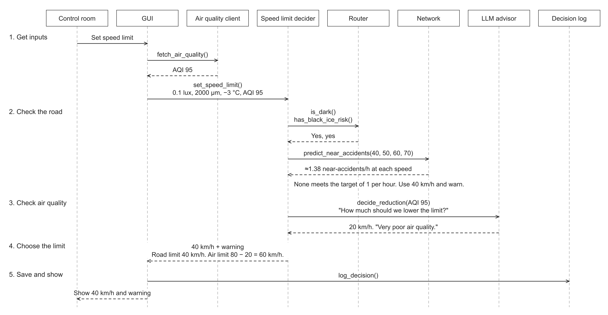
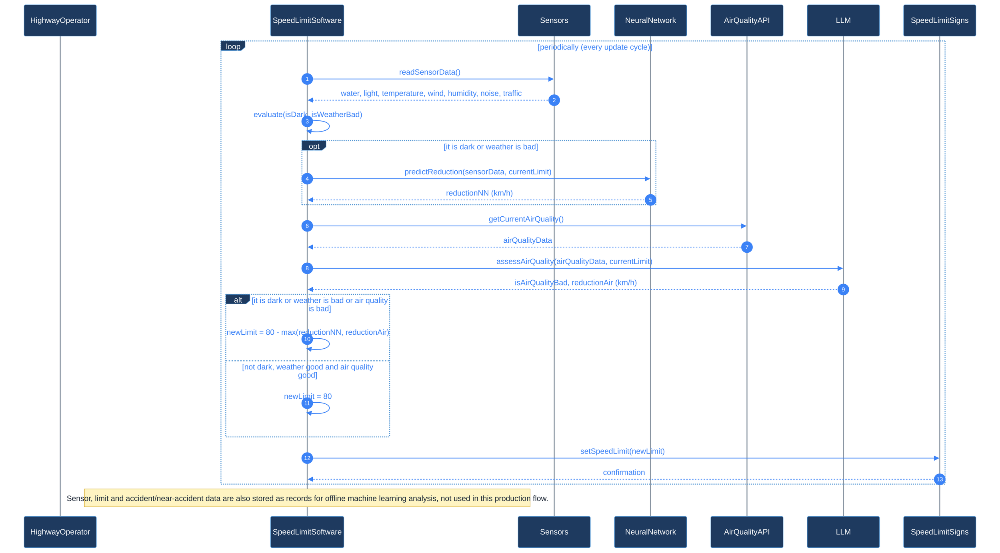
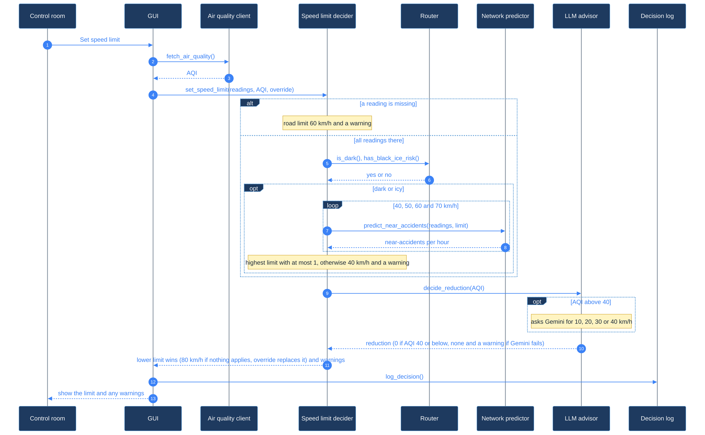

# 9. Sequence diagram (LLM Architecture deck)

Draw a sequence diagram showing which components interact, and in what order, to set the speed limit.

## Round 1

- If a road reading is missing, use 60 km/h as the road limit.
- If the LLM fails, skip the air-quality reduction and show a warning.
- The control room can override the result.

## Round 2

Note: if you want the LLM call to happen only when needed, it can be placed in an `opt` as well. As drawn, air quality is queried every cycle because the task states that it is an independent reason to reduce the limit.

## Round 3

## Comparison

For Round 1, I drew one example the way the lecture does: a dark, icy hour with an AQI of 95, with the real function names from our code and the actual values. It's simple and easy to read, and you can follow it from the click to the final 40 km/h.

The AI rounds made the diagram more complex and used more technical language than I did. Round 2 used loop, opt and alt boxes for the conditions, but it put the whole system into one SpeedLimitSoftware box, added parts we don't have, like the road signs, and its network returns a reduction instead of predicting near-accidents.

Round 3 kept those boxes but was more to the point. It used our own components from 08, dropped the parts we don't have, and showed the network predicting near-accidents for each limit. It's the most accurate of the three, but still more technical and harder to read than mine.

What I learnt: the AI is good at covering every case in the right notation, but a simple example is easier to read and to explain.
